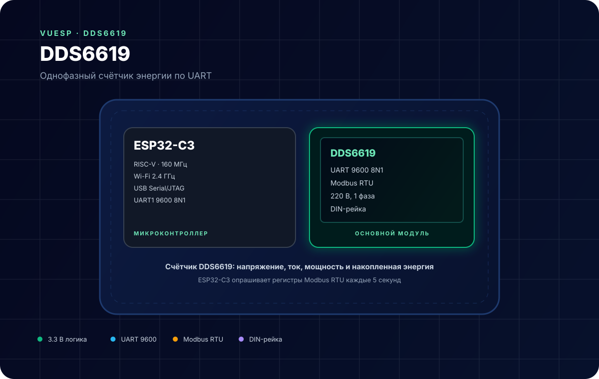
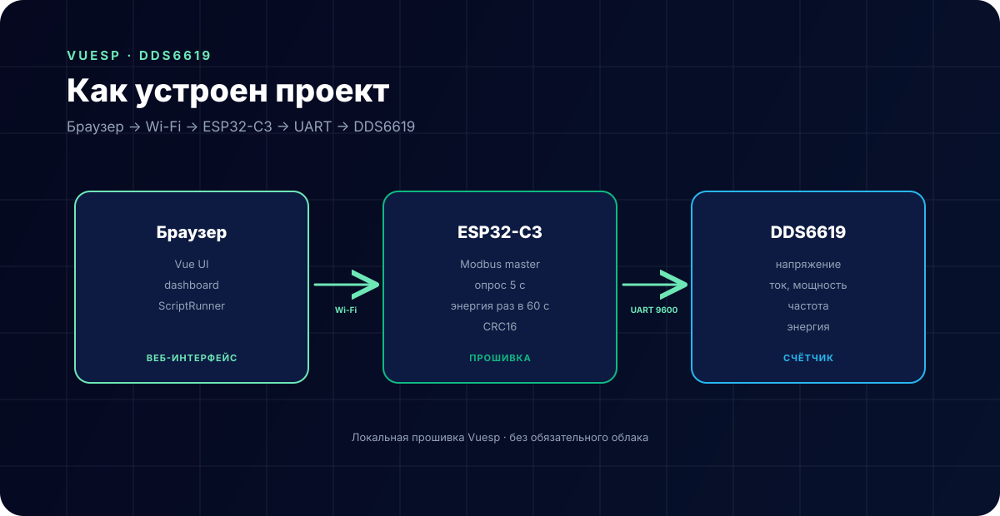

# DDS6619 — счётчик электроэнергии



**Коротко:** `vuesp.DDS6619` — прошивка Vuesp для однофазного счётчика **DDS6619**. ESP32-C3 опрашивает счётчик по Modbus RTU через UART и показывает напряжение, ток, мощность, частоту и накопленную энергию в локальном веб-интерфейсе.

## Что это за устройство

DDS6619 — однофазный счётчик электроэнергии на DIN-рейку с интерфейсом RS485/UART. Внутри — измерительная микросхема и Modbus-регистры, из которых читаются мгновенные значения и накопленные счётчики энергии.

В проекте ESP32-C3 работает как **Modbus-мастер**:

- раз в 5 секунд читает напряжение, ток, мощность и частоту;
- раз в 60 секунд читает накопленную энергию (прямую, обратную, реактивную);
- при старте читает версию/параметры связи;
- проверяет CRC16 каждого ответа.

## Характеристики

| Параметр | Значение |
| --- | --- |
| Микроконтроллер | ESP32-C3 (RISC-V, 160 МГц) |
| Интерфейс счётчика | UART, 9600 8N1, Modbus RTU |
| Питание счётчика | 220 В, 1 фаза |
| Питание платы | 5 В / 3.3 В |
| Логика | 3.3 В |
| Файловая система | LittleFS |
| Среда | PlatformIO + Arduino |

## Распиновка

UART вынесен на `Serial1`:

| Сигнал | GPIO ESP32-C3 | Куда |
| --- | --- | --- |
| RX | GPIO6 | TX счётчика |
| TX | GPIO5 | RX счётчика |
| GND | GND | GND счётчика |

В прошивке (`src/device/device.cpp`):

```cpp
Serial1.begin(9600, SERIAL_8N1, 6, 5);
```

> **Важно.** Прошивка не управляет линией `DE/RE` RS-трансивера. Если у счётчика выход RS485 (клеммы A/B), нужен конвертер **с автоматическим направлением** (например, на MAX13487) или TTL-выход счётчика. Обычный MAX485 с ручным `DE` без доработки работать не будет.

## Схема подключения

```text
DDS6619 TX  ─────────►  GPIO6 (RX) ESP32-C3
DDS6619 RX  ◄─────────  GPIO5 (TX) ESP32-C3
DDS6619 GND ───────────  GND
```

- Линии TX/RX соединяются **накрест**.
- Общий провод обязателен: без общего GND UART работает нестабильно.
- Счётчик и ESP32-C3 питаются от разных источников; 220 В подключайте только к счётчику.
- Если используется RS485-конвертер, линия A/B подключается к счётчику, а сторона TTL — к GPIO5/GPIO6.

## Регистры Modbus

| Регистр | Что читается | Единицы в прошивке | Масштаб в UI |
| --- | --- | --- | --- |
| `0x0000` | напряжение | 0.1 В | `/10` → В |
| `0x0003` | ток | 0.01 А | `/100` → А |
| `0x0008` | активная мощность | Вт | Вт |
| `0x0014` | cos φ | — | не читается |
| `0x001A` | частота | 0.01 Гц | `/100` → Гц |
| `0x001D` | общая активная энергия | 0.01 кВт·ч | `/100` |
| `0x0027` | прямая активная энергия | 0.01 кВт·ч | `/100` |
| `0x0031` | обратная активная энергия | 0.01 кВт·ч | `/100` |
| `0x003B` | реактивная энергия | 0.01 квар·ч | `/100` |
| `0x0061` | адрес | — | только чтение |
| `0x0062` | скорость | — | только чтение |
| `0x0063` | формат | — | только чтение |

Ответы счётчика содержат четырёхбайтовые значения с переставленными словами — в прошивке это учитывает `parseFloat()`.

## Как устроен проект



- `src/device/device.cpp` — запросы Modbus, разбор ответов, CRC16, опрос по таймеру;
- `src/modbus/` — вспомогательные функции Modbus;
- `vue/json/dashboard.json` — плитки напряжения, тока, мощности, энергии;
- `vue/` — веб-интерфейс Vuesp.

Значения складываются в структуру `Device` (`src/const/struct.h`) и рассылаются по WebSocket. Dashboard применяет масштабы из таблицы выше.

## ScriptRunner

Прошивка регистрирует `http` и провайдер `$display`:

| Функция | Назначение |
| --- | --- |
| `http(method, url, count, num, data)` | заготовка HTTP-запроса |
| `$display` | строковый буфер для сценариев |

Пример вывода значения в лог:

```text
log('meter ready');
```

## Сборка и прошивка

```bash
cd vue
npm ci
npm run build-web

cd ..
~/.platformio/penv/bin/pio run
~/.platformio/penv/bin/pio run -t buildfs
```

Прошивка: `build/esp32-c3-devkitm-1/firmware.bin`, FS: `build/esp32-c3-devkitm-1/littlefs.bin`.

## Ограничения

- Только однофазный счётчик; трёхфазные модели не поддерживаются.
- Прошивка только читает регистры — запись адреса, скорости и формата не реализована.
- Нет управления `DE/RE`: нужен TTL-UART или конвертер с автонаправлением.
- При ошибке CRC ответ отбрасывается, значение остаётся прежним — в UI это выглядит как «замершее» показание.
- Энергия обновляется раз в минуту, поэтому плитка может отставать от мгновенных значений.
- cos φ в dashboard не выводится, хотя запрос для него есть в коде (закомментирован).

## Источники

- [DDS6619 — описание и Modbus-карта (Sinotimer)](https://www.sinotimer.com/)
- [Modbus Application Protocol](https://modbus.org/specs.php)
- [Документация Vuesp](https://docs.vuesp.ru)
